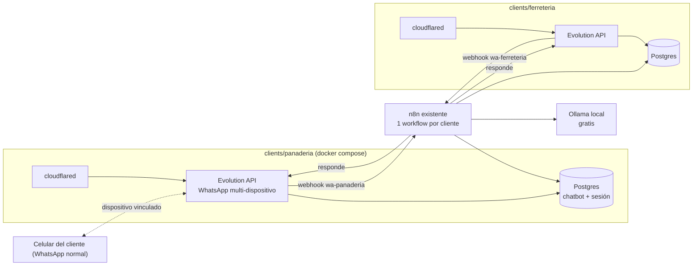

# App WhatsApp: chatbot con IA multicliente

Entorno para atender el WhatsApp de varios clientes (negocios) con un chatbot de IA, todo en Docker Compose y a **costo cero** (la IA corre local con Ollama hasta que se agreguen tokens de una IA paga).

Cada cliente tiene su propio **entorno + base de datos + túnel de cloudflared**, y las automatizaciones viven en **tu n8n que ya corre en un contenedor**. El número de WhatsApp se vincula como "dispositivo vinculado" (igual que WhatsApp Web), así que **el dueño sigue usando WhatsApp normalmente en el celular**.



Todo se comunica por una red Docker compartida, `wa-net`, a la que se conecta tu contenedor de n8n.

## Qué hay en el repo

| Ruta | Para qué |
|---|---|
| `template/compose.yaml` | Entorno de un cliente, con el mismo esquema que panaderia-reservas: `db` (Postgres 17), `evolution` (Evolution API v2.3.7, Baileys) y túnel `tunel` (temporal) o `tunel-cf` (subdominio fijo) |
| `template/db/init/01_schema.sql` | Tablas del bot (`bot_config`, `knowledge`, `contacts`, `messages`) y la lógica en funciones SQL |
| `template/db/ejemplo-negocio.sql` | Ejemplo para cargar horarios, precios, etc. de un negocio |
| `template/n8n/workflow.json` | Workflow del chatbot (plantilla, se genera uno por cliente) |
| `template/n8n/credentials.json` | Credenciales de n8n del cliente (plantilla) |
| `scripts/nuevo-cliente.ps1` | Crea un cliente de punta a punta |
| `scripts/tunel-cf.ps1` | Pasa un cliente a túnel fijo con subdominio propio (ej. `wa-prueba.destru.online`) |
| `compartido/compose.yaml` | Servicios compartidos: `ollama-puente` (para Docker sobre WSL, como Kiri) |
| `scripts/cliente.ps1` | Maneja un cliente: `up`, `down`, `estado`, `qr`, `sql`, `backup`, `logs`, `url`, `lista` |
| `clients/<slug>/` | Lo genera el script. **No se sube a git** (tiene claves) |

## Requisitos (todo gratis)

- Windows con Docker Desktop (o el motor Docker que uses) y PowerShell.
- Tu contenedor de n8n corriendo. Por defecto se busca uno llamado `n8n`; si se llama distinto, pasá `-N8nContainer <nombre>` (lo ves con `docker ps`).
- [Ollama](https://ollama.com) en Windows, con un modelo descargado: `ollama pull llama3.2:3b`.
  Para que n8n (dentro de Docker) lo alcance, Ollama tiene que escuchar en todas las interfaces: variable de entorno de Windows `OLLAMA_HOST=0.0.0.0` y reiniciar Ollama.
  En **Kiri** (Docker sobre WSL), `host.docker.internal` apunta a la máquina virtual de WSL y no a Windows. El script lo detecta y levanta `ollama-puente` (en `compartido/compose.yaml`), que averigua la IP de Windows en cada arranque. Así n8n usa `http://host.docker.internal:11435` y no se rompe al reiniciar la PC.
- Opcional: cuenta gratis de Cloudflare con un dominio, si querés una URL fija por cliente.

## Crear un cliente

```powershell
cd app-whatsapp
.\scripts\nuevo-cliente.ps1 -Slug panaderia -Nombre "Panadería San José"
```

Si Windows bloquea el script: `powershell -ExecutionPolicy Bypass -File scripts\nuevo-cliente.ps1 -Slug panaderia -Nombre "Panadería San José"`.

El script:

1. Crea la red `wa-net` (si no existe) y le conecta tu contenedor de n8n.
2. Copia la plantilla a `clients\panaderia\` y genera un `.env` con contraseñas aleatorias y puertos libres (Evolution 8081, 8082, ...; base 5440, 5441, ... para DBeaver/pgAdmin).
3. Levanta `db` + `evolution` + túnel con `docker compose`.
4. Crea la instancia de WhatsApp y abre `qr.png`.
5. Importa en n8n las credenciales y el workflow **"WA Panadería San José - Chatbot IA"** y lo activa.

Después:

1. En el celular del negocio: **WhatsApp > Dispositivos vinculados > Vincular dispositivo** y escanear `qr.png` (si venció: `.\scripts\cliente.ps1 panaderia qr`).
2. Cargar la info del negocio: `.\scripts\cliente.ps1 panaderia sql` y pegar lo de `template\db\ejemplo-negocio.sql` adaptado.
3. Probar escribiéndole al número desde otro teléfono.

Opciones útiles: `-OllamaModel qwen2.5:3b`, `-OllamaUrl http://otra-pc:11434`, `-SinTunel`, `-SinN8n`.

## Túneles de Cloudflare

- **Sin nada configurado** se usa el perfil `tunel` (igual que en panaderia-reservas): gratis y sin cuenta, pero la URL `*.trycloudflare.com` cambia en cada reinicio. Verla: `.\scripts\cliente.ps1 panaderia url`.
- **URL fija con tu dominio (recomendado)**: un comando y listo, sin instalar cloudflared ni copiar tokens a mano:
  ```powershell
  .\scripts\tunel-cf.ps1 -Slug panaderia -Dominio destru.online        # -> https://wa-panaderia.destru.online
  ```
  La primera vez aparece un link para iniciar sesión en Cloudflare y elegir el dominio; la sesión queda en `%USERPROFILE%\.cloudflared`. El script crea el túnel `wa-<slug>`, el DNS del subdominio, guarda el token en el `.env` del cliente y cambia al perfil `tunel-cf`. También se puede al crear el cliente: `nuevo-cliente.ps1 ... -Dominio destru.online`.
- **URL fija a mano**: en Cloudflare Zero Trust > Networks > Tunnels creá un túnel por cliente, con un *public hostname* (ej. `wa-panaderia.tudominio.com`) apuntando a `http://evolution:8080`. Copiá el token y:
  ```powershell
  .\scripts\nuevo-cliente.ps1 -Slug panaderia -Nombre "Panadería San José" -TunnelToken "eyJh..." -PublicUrl "https://wa-panaderia.tudominio.com"
  ```
  En un cliente ya creado: poné `COMPOSE_PROFILES=tunel-cf`, `CLOUDFLARE_TUNNEL_TOKEN=...` y `EVOLUTION_PUBLIC_URL=...` en su `.env` y corré `.\scripts\cliente.ps1 panaderia up`.

El túnel expone el panel de Evolution (`/manager`, protegido con la API key del `.env`) para vincular o revisar el WhatsApp a distancia. La comunicación Evolution ↔ n8n va por la red interna y no necesita túnel.

## Cómo convive el bot con el uso normal del celular

- El número queda como **dispositivo vinculado**: el dueño sigue chateando desde el celu como siempre, con notificaciones (`alwaysOnline` y `readMessages` están apagados, así el bot no marca nada como leído).
- **Pausa humana**: si el dueño le escribe a un contacto desde el celu, el bot se calla con ese contacto durante `human_pause_minutes` (60 por defecto).
- Comandos que el dueño puede escribir en el chat de un contacto: `#bot` reactiva el bot ahí mismo, `#nobot` lo apaga para ese contacto hasta escribir `#bot`.
- Se ignoran grupos, estados y canales.
- Audios e imágenes: por ahora el bot responde que solo lee texto.

## Qué hace el workflow de n8n

`WhatsApp entrante` (webhook `wa-<slug>`) → `Normalizar` → ¿lo escribió el dueño?
- **Sí**: espera 4 s → `bot_owner_message()` (guarda y pausa, o ignora si fue el propio bot).
- **No**: `bot_ingest()` (guarda contacto y mensaje, evita duplicados y devuelve config, info del negocio e historial) → ¿responder? → `Armar prompt` → `IA (Ollama local)` → `Enviar por WhatsApp` → `bot_save_reply()`.

La lógica está en funciones SQL dentro de la base de cada cliente, así el workflow queda simple y es igual para todos.

## Pasar a IA paga (al final)

Hoy todo usa Ollama local (gratis). Cuando agregues tokens, en el workflow del cliente:

1. Creá en n8n una credencial **Header Auth** con la API key (Anthropic: nombre `x-api-key`; OpenAI: nombre `Authorization`, valor `Bearer sk-...`).
2. En el nodo `IA (Ollama local)` cambiá la URL (`https://api.anthropic.com/v1/messages` o `https://api.openai.com/v1/chat/completions`), elegí esa credencial y, para Anthropic, agregá el header `anthropic-version: 2023-06-01`.
3. Ajustá `Armar prompt` y `Extraer respuesta` al formato del proveedor (Anthropic: `system` va aparte de `messages` y la respuesta está en `content[0].text`; OpenAI: la respuesta está en `choices[0].message.content`).
4. Cambiá el modelo del cliente: `UPDATE bot_config SET ai_provider = 'anthropic', ai_model = '<modelo>';`

Se puede hacer cliente por cliente: unos con IA paga y otros con Ollama.

## Operación diaria

```powershell
.\scripts\cliente.ps1 todos lista          # todos los clientes
.\scripts\cliente.ps1 panaderia estado     # contenedores + si WhatsApp está conectado
.\scripts\cliente.ps1 panaderia logs
.\scripts\cliente.ps1 panaderia backup     # pg_dump a clients\panaderia\backups
.\scripts\cliente.ps1 panaderia down       # apagar (los datos quedan en volúmenes)
```

## Advertencias

- Evolution API usa Baileys, una conexión **no oficial** a WhatsApp (como WhatsApp Web). Es gratis y no desvincula el celular, pero WhatsApp puede bloquear números que manden spam o mensajes masivos. Usalo para responder, no para campañas.
- Cada cliente consume unos 300 a 500 MB de RAM (Postgres + Evolution). Un modelo de Ollama de 3B necesita unos 3 a 4 GB más, compartidos entre todos.
